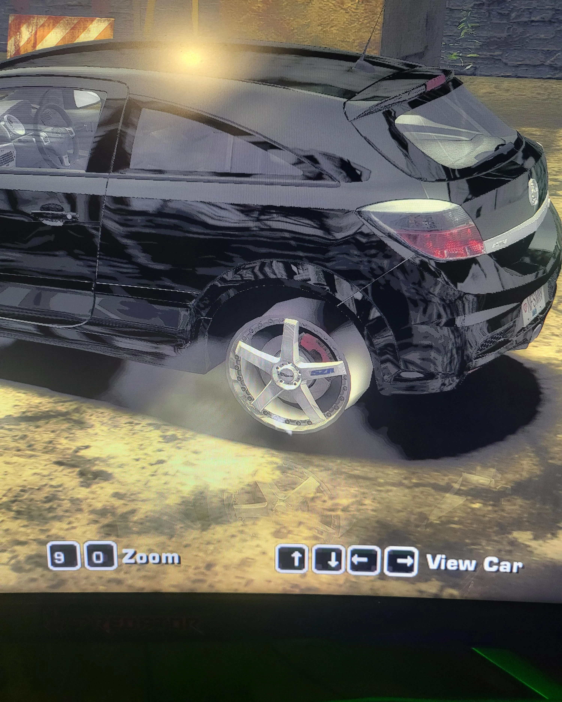

# NFSMW (2005) Missing Tires Fix

Fixes aftermarket rims rendering **without tires** in Need for Speed: Most Wanted (2005), on AI cars, on your own car and in the front-end showroom.



## Why it happens

Every aftermarket rim in `CARS\WHEELS\GEOMETRY.BIN` (all 656 wheel models) uses the textures `TIRE_STYLE01` and `TIRE_STYLE01_N`. **Neither texture exists anywhere in the retail game files.** The game normally swaps them at runtime for the car's own `<CAR>_TIRE` texture. When that swap doesn't happen, the rim renders but the tire is invisible.

This fix adds the two textures to the `Global\GlobalTextures.tpk` pack inside `GLOBAL\GLOBALB.LZC`, so a failed swap shows a generic tire instead of nothing. It's the same thing NFSMW Unlimiter's full install does.

Full write-up: https://github.com/ThirteenAG/WidescreenFixesPack/issues/2357

## Requirements

- NFS Most Wanted (2005) PC, `speed.exe` v1.3.
- Windows PowerShell 5.1 or PowerShell 7 (both ship with Windows).
- The tire textures from the **official NFSMW Unlimiter download** (they are not redistributed here, credit: nlgxzef):
  https://github.com/nlgxzef/NFSMWUnlimiter/releases
  Extract it and use the folder `Binary\Textures\GlobalB\GlobalTextures` (it has `TIRE_STYLE01.dds` and `TIRE_STYLE01_N.dds`).

If you already installed Unlimiter fully through Binary, you don't need this.

## Apply

Open PowerShell in this folder and run:

```powershell
powershell -ExecutionPolicy Bypass -File .\Apply-TiresFix.ps1 -GameDir "C:\Games\Need for Speed Most Wanted" -UnlimiterTexturesDir "C:\Downloads\NFSMW.Unlimiter\Binary\Textures\GlobalB\GlobalTextures"
```

It backs up `GLOBALB.LZC` (and `GLOBALB.BUN` if present) as `*.tiresfix.bak` before writing.

## Undo

```powershell
powershell -ExecutionPolicy Bypass -File .\Restore-TiresFix.ps1 -GameDir "C:\Games\Need for Speed Most Wanted"
```

## How it works

- `Jdlz.ps1` decompresses EA's JDLZ format; `JdlzCompress.ps1` recompresses it (LZ77). The output has to stay smaller than the decompressed data, or the game crashes on load.
- `InjectTiresV2.ps1` inserts the two DXT1 textures into the GlobalTextures pack. It keeps the hash table sorted and the existing texture data byte-for-byte. Everything after the pack is shifted by a multiple of 0x800 to preserve alignment, and the result is verified by decompressing it again.
- Mods that rewrite `GLOBALB.LZC` afterwards will undo the fix; just run it again.
